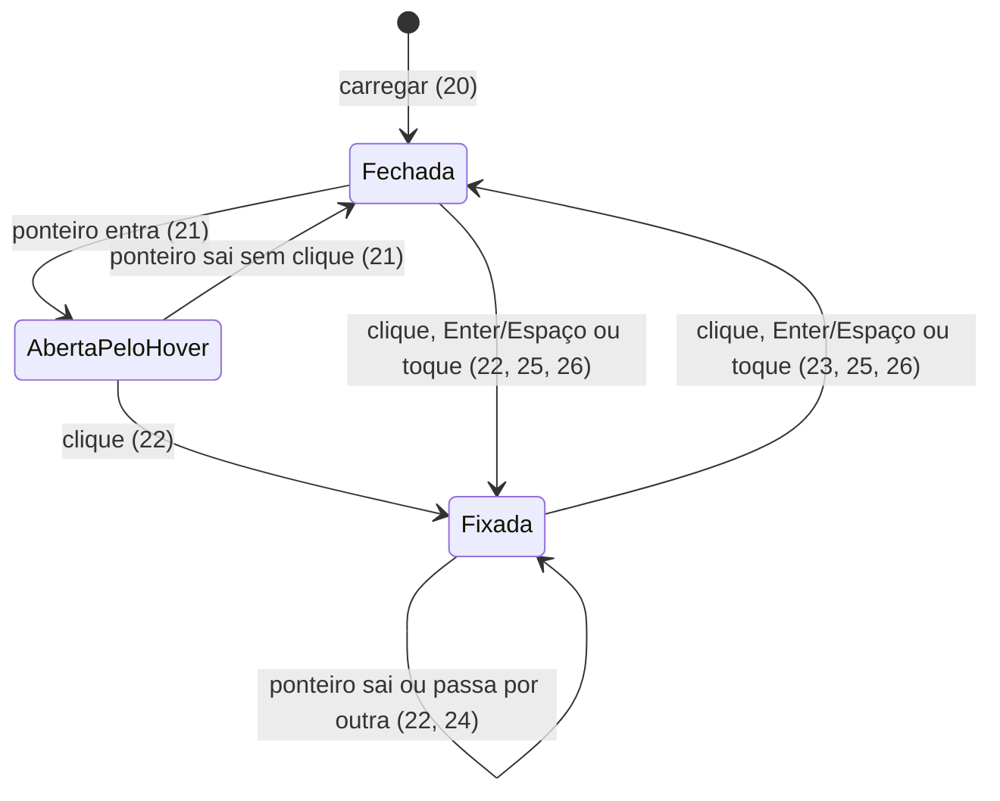

# Landing page do portfólio — correções visuais (Hero, notebook, glitch, FAQ, só escuro)

> Implemente com **tlc-implement**.
> Cada critério abaixo vira uma verificação com prova, citada pelo número. Nada em
> `Unresolved` é decidido durante a implementação.

## Intent

Hoje a Hero de `/` mistura tudo: o notebook que abre com a rolagem prende a primeira tela por
três telas de altura, e sete ícones de vidro o cercam. Depois da Hero, todas as seções repetem uma
malha no fundo. O FAQ só abre com clique, o glitch dos títulos é curto demais para ser notado (2
quadros em 320 ms) e o tema claro, avaliado pelo dono do portfólio, "fica bem ruim". Quem paga é
o próprio dono: a página não comunica a direção visual que ele quer mostrar. A fonte não traz
métrica nem prazo.

Com esta tarefa, a Hero passa a ter uma tela só, com malha interativa, a bola de luz azul em leve
movimento, os ícones de vidro `cursor`, `atom` e `logo` e o texto. O notebook vira a seção
`#notebook`, antes de `#cases`, sem modelos flutuantes. A malha some de todo o resto. O parallax
fica como está. O glitch ganha uma rajada mais rica, o FAQ abre no hover e fixa no clique, e a
página fica só no tema escuro.

28 critérios em 7 fatias · 1 decisão de mão única (mantida da tarefa anterior) · 1 em aberto, 1 bloqueia o go-live

## Criteria

### Seções e ordem

1. Quando `/` carrega, então `<main>` contém dez `<section>`, nesta ordem e com estes `id`:
   `hero`, `prova-social`, `sobre`, `solucoes`, `notebook`, `cases`, `workflow`, `depoimentos`,
   `faq`, `contato`. Todas, exceto `hero` e `notebook`, continuam com um `<h2>` e texto lorem
   ipsum; `#notebook` não tem texto visível e tem `aria-label="Notebook"`.

### Hero: malha, luz azul, ícones de vidro e texto, sem notebook

2. Quando `/` carrega com a rolagem em 0, em 1440×900, então `#hero` tem 900 px de altura (uma
   tela, sem rolagem presa) e mostra o `<h1>`, o subtítulo e o CTA inteiros; nenhum notebook
   aparece em `#hero`.
3. Quando `#hero` renderiza, então os ícones de vidro dela são exatamente `cursor`, `atom` e
   `logo`; `note`, `flag`, `wave` e `brick` não aparecem em nenhum lugar da página.
4. Sempre, os três ícones da Hero se comportam como hoje: inclinam na direção do ponteiro
   (`MOTION.parallaxTilt`, `MOTION.parallaxShift`), o ícone sob o ponteiro inclina mais e cresce
   para 1,06× (`MOTION.hoverScale`), e os anéis do `atom` giram com `ORBIT`.
5. Sempre, a malha interativa existe só dentro de `#hero` e se comporta como hoje: linhas retas a
   cada 48 px; o ponteiro curva as linhas a até 160 px dele, no máximo 12 px; elas voltam a
   ficar retas em até 800 ms depois que o ponteiro para ou sai.
6. Sempre, nenhuma seção além de `#hero` tem malha no fundo: o elemento `sections-grid` deixa de
   existir e nenhum outro fundo de linhas o substitui. Os dois brilhos radiais das seções
   (`primary` e `steel`) continuam.
7. Quando `#hero` renderiza, então a bola de luz azul aparece no alto à esquerda, como hoje: um
   núcleo emissivo em `mist` com um halo difuso em `primary`.
8. Enquanto o navegador não pede movimento reduzido, o centro do núcleo se move devagar em
   percurso contínuo, sempre a até 40 px do ponto de repouso (em 1440×900); duas capturas com 2 s
   de intervalo mostram o centro em posições diferentes.
9. Enquanto o navegador está em `prefers-reduced-motion: reduce`, o centro do núcleo fica parado:
   duas capturas com 2 s de intervalo diferem em no máximo 1 px.
10. Sempre, o núcleo e o halo da luz aparecem só em `#hero`: em nenhuma outra seção, incluindo
    `#notebook`, há o núcleo emissivo nem o halo.

### Notebook como seção própria, antes dos cases

11. Quando o visitante rola por `#notebook`, então a seção prende a cena por 300vh, como a Hero
    faz hoje, e o notebook endireita, abre e liga nas janelas `STRAIGHTEN`, `OPEN` e `POWER_ON`,
    medidas pelo progresso da própria seção: fechado quando o topo da seção chega ao topo da tela,
    com a tela ligada mostrando `SCREEN_URL` antes de a seção terminar.
12. Enquanto `#notebook` ocupa a tela, então nenhum elemento flutuante aparece nela (nem ícones
    de vidro, nem as formas do parallax), não há malha, e a cena mantém o piso, os dois holofotes
    e a sombra de contato de hoje sobre fundo `ink`.
13. Enquanto o navegador está em `prefers-reduced-motion: reduce`, o notebook continua abrindo e
    ligando com a rolagem (11).

### Parallax inalterado

14. Sempre, nas seções depois da Hero (exceto `#notebook`, 12), o parallax continua como hoje:
    fundo a 0,2×, meio a 0,5× com o octaedro e o cubo arredondado brilhantes, e frente a 1,3× com
    as barras de "código" desfocadas junto às bordas; com movimento reduzido, as camadas ficam
    paradas.

### Glitch mais rico nos títulos

15. Quando um `<h1>` ou `<h2>` entra na tela (metade visível) ou recebe o ponteiro, então roda
    uma única rajada de no máximo 600 ms: 6 quadros com as cópias visíveis e um quadro final
    limpo. Em cada quadro, a cópia em `primary` e a cópia em `mist` aparecem recortadas em 3
    faixas horizontais e deslocadas até 8 px na horizontal.
16. Durante a rajada, o texto principal do título treme até 2 px na horizontal; ao fim dela, o
    texto, as cópias e o tremor voltam a zero e nada se repete sozinho.
17. Enquanto uma rajada roda, um novo gatilho no mesmo título não inicia outra; a regra antiga de
    no máximo 3 mudanças por segundo deixa de valer.
18. Sempre, as cópias têm `aria-hidden="true"`: o leitor de tela lê cada título uma única vez.
19. Enquanto o navegador está em `prefers-reduced-motion: reduce`, nenhuma rajada dispara.

### FAQ abre no hover, fixa no clique

20. Quando `/` carrega, as 5 perguntas de `#faq` estão fechadas.
21. Quando o ponteiro do mouse entra numa pergunta fechada, a resposta aparece; quando sai do item
    (pergunta e resposta) sem ter clicado, a resposta some em até 300 ms.
22. Quando o visitante clica numa pergunta, fechada ou aberta pelo hover, ela fica aberta depois
    que o ponteiro sai do item.
23. Quando o visitante clica numa pergunta fixada, ela fecha.
24. Dado que uma pergunta está fixada, quando o ponteiro passa por outra, a outra abre e a fixada
    continua aberta.
25. Quando o foco do teclado está numa pergunta, Enter ou Espaço alterna entre fixada e fechada, e
    o leitor de tela anuncia se ela está expandida.
26. Quando o visitante toca numa pergunta em tela de toque, ela alterna entre fixada e fechada,
    sem depender de hover.

### Só tema escuro

27. Quando o navegador está em `prefers-color-scheme: light`, a página fica igual ao tema escuro:
    fundo `ink`, texto `mist`, cópias do glitch em `primary` e `mist`, malha da Hero em `mist`,
    `color-scheme` do `<html>` igual a `dark` e, em `#notebook`, céu, névoa e piso em `ink`.
    Quando o esquema do sistema muda com a página aberta, nenhuma cor da página muda.
28. Em 375×667, a página não tem rolagem horizontal.

## States

Pergunta do FAQ (20–26).

## Out of scope

- Trocar as formas SVG do parallax pelos modelos de vidro — "deixa assim então por enquanto".
- Mudar o parallax de qualquer outra forma — "O efeito parallax está bom."
- Seletor de tema ou qualquer tema claro — "não vamos ter light".
- Apagar `note.glb`, `flag.glb`, `wave.glb` e `brick.glb` de `public/models/glass/` — deixam de
  ser carregados; remover os arquivos é limpeza à parte.
- Destino real dos CTAs e conteúdo real — Unresolved 1.

## Observable

| Surface | Decision | Landing |
| --- | --- | --- |
| tela `/` | estado vazio | n/a - conteúdo estático, nunca fica vazio |
| tela `/` | carregamento | existing - `Suspense fallback={null}` mantém cada canvas vazio sobre `ink` até os GLB carregarem |
| tela `/` | erro (WebGL indisponível, GLB ausente) | existing - sem tratamento hoje; `findParts` lança erro se faltar um nó do modelo |
| tela `/` | não autorizado | n/a - página pública |
| tela `/` | ordem e densidade das seções | 1, 2 |
| tela `/` | ação destrutiva | n/a - nenhuma |
| tela `/` | largura móvel e toque | 26, 28; em toque a malha fica reta (existing - `hero-grid.tsx` ignora `pointerType === 'touch'`) |
| tela `/` | movimento reduzido | 9, 13, 14, 19 |
| tela `/` | tema | 27 |
| seção `#notebook` | texto e rótulo | 1 |
| FAQ | estado inicial | 20 |
| FAQ | alternância por mouse, teclado e toque | 21–26 |

## Swept

- validation: n/a - não há campo de entrada
- failure modes: existing - um GLB sem os nós esperados lança erro em `findParts`; sem WebGL as cenas não renderizam; esta tarefa não muda o tratamento
- idempotency and retry: n/a - nada é gravado nem enviado
- authorization: n/a - página pública, sem sessão
- concurrency and ordering: 17 (gatilho durante uma rajada em curso); 22 (clique numa pergunta já aberta pelo hover, seguido da saída do ponteiro); 24 (hover em outra pergunta com uma fixada)
- data lifecycle: n/a - nenhum dado persistido
- external-dependency failure: existing - o iframe de `SCREEN_URL` (Kune na Vercel) fica preto se falhar, agora dentro de `#notebook`
- state transitions: 20–26 (pergunta do FAQ, ver States); 15–16 (título limpo ↔ rajada)
- observability: n/a - página estática sem telemetria; FPS com dois canvas WebGL (Hero e notebook) é meta medida à mão no DevTools, não critério

## Impact

| Front | What changes |
|---|---|
| domain | novo `id` público `notebook` (âncora de URL); `#hero` deixa de ter 300vh |
| hero | `components/organisms/laptop-hero` se divide em dois canvas: a Hero fica com `HeroGrid`, a luz, os três ícones e `HeroCopy`; o notebook, o piso, os holofotes e `ContactShadows` vão para `#notebook`. `useScrollProgress` já mede o progresso pela própria seção, então as janelas de 11 não mudam |
| hero | o `pointLight` de `HeroLight` iluminava o notebook e o piso (antigos T16–T17); agora ilumina só os três ícones. `e2e/hero-light.spec.ts` lê os pixels do canvas `hero-scene` |
| ícones de vidro | `GLASS_LAYOUT` cai de 7 para 3 entradas (`cursor`, `atom`, `logo`); as âncoras atuais foram pensadas em volta do notebook e o `logo` (`[-0.78, 0]`) fica perto do texto, então as posições podem ser reajustadas na revisão visual sem mudar 4 |
| parallax e notebook | o bloco `relative isolate` em `app/page.tsx` envolve hoje todas as seções depois da Hero com `SectionsBackdrop` e `ParallaxField`; `#notebook` no meio dele ficaria sob as formas do parallax, o que 12 proíbe |
| fundo das seções | o `div` `sections-grid` de `sections-backdrop.tsx` sai; os brilhos ficam |
| glitch | `lib/glitch.ts` tem `GLITCH.maxChangesPerWindow`, `fitsRate` e `burstStart` só para impor a regra antiga de 3 mudanças por segundo, que 17 derruba; `busyUntil` continua sendo o que impede uma rajada sobreposta. Cada cópia hoje mostra uma faixa (`inset()`); 3 faixas (15) pedem outro recorte, e qualquer elemento novo também precisa de `aria-hidden` (18). Sem o limite, a rajada pode passar do limite de flashes da WCAG 2.3.1 num título grande; risco aceito pelo usuário, mitigado por 17 e 19, sem medição de área |
| FAQ | `faq.tsx` usa `
` nativo e é server component. Clicar num `
` já aberto pelo hover dispara o toggle nativo e fecha a pergunta, ao contrário de 22; o componente passa a precisar de estado no cliente |
| tema | `app/globals.css` passa a ter um conjunto só de variáveis (as escuras) e perde o `@media (prefers-color-scheme: dark)`. `onSchemeChange` e `useSchemeValue` (`lib/media-preferences.ts`) existem só para trocar o tema ao vivo (`hero-scene.tsx`, `hero-grid.tsx`) e ficam sem uso. Os favicons claro e escuro seguem o tema da aba do navegador, não da página, e não mudam |
| testes | ficam obsoletos e são substituídos: em `e2e/theme.spec.ts`, os testes do tema claro e da troca ao vivo; em `e2e/hero-light.spec.ts`, os de piso e notebook iluminados e do halo no claro; em `e2e/glitch.spec.ts`, a malha de 80 px e o laço claro/escuro; em `lib/glitch.test.ts`, o limite de 3 mudanças por 1000 ms; em `e2e/sections.spec.ts`, as nove seções; em `e2e/reduced-motion.spec.ts` e `e2e/hero-light.spec.ts`, os testes que rolam pela Hero para abrir o notebook passam a rolar por `#notebook`. Cada remoção é citada no PR com o critério que a substitui |
| tarefa anterior | `.tasks/portfolio-lp-visual.md` traz no topo a lista dos critérios que esta tarefa substitui |
| stored data | nothing to migrate |

## Decided

| Decision | Shape | Alternative rejected |
|---|---|---|
| Nenhuma dependência nova de runtime (mantida da tarefa anterior) | `dependencies` do `package.json` inalterado; os dois canvas seguem o padrão `<Canvas>` + `@react-three/drei` que o hero já usa | Qualquer pacote novo para rolagem, glitch ou 3D |

## Sources

- Pedido do usuário nesta conversa (sem endereço; trechos decisivos citados):
  "A 'malha' que reage ao hover do mouse no background só deve existir na Hero." (5);
  "O notebook abrindo não deveria estar na home, o nobook abrindo deve ser uma seção antes dos
  cases." (1, 2, 11);
  "A luz azul deve ficar na Hero, ela pode se mexer um pouco." (7–10);
  "O efeito de glitch nos títulos, gostei mas pode ficar melhorar." (15–19);
  "Os accordions na seção perguntas frequentes devem abrir no hover, se o usuário clicar ele fica
  aberto." (20–26);
  "O efeito parallax está bom." (14);
  "O que não for a Hero, não deve receber a malha(Grid) no background." (6);
  "Não precisamos ter versão light, pelo visto fica bem ruim, portanto, não vamos ter light."
  (27).
- Respostas do usuário às perguntas do plano (sem endereço):
  primeira rodada — "Não precisamos dos modelos flutuantes na seção do notebook" (12); glitch —
  escolheu "Rajada mais rica": "De 2 para 6 quadros curtos em até 600 ms, 3 faixas por cópia,
  deslocamento até 8 px e um leve tremor do texto principal [...] Derruba a regra atual de no
  máximo 3 mudanças por segundo (T22)." (15–17).
  Segunda rodada — parallax: "sobre os modelos que falei pra desfazer que estão no parallax,
  deixa assim então por enquanto" (14); ícones: "Podemos manter os elementos atom, cursor e logo
  na Hero então, já que eles não vão ser usados em mais nenhum lugar." (3, 4); luz: "A luz azul
  que falei que deve ficar na Hero se trata daquela bola azul encandecente que temos hoje na
  Hero." (6, 7); "Glitch: Pode seguir o recomendado." (15–19, risco WCAG aceito); "Nas outras
  pendências siga o recomendado." — **user delegated**: rótulo de `#notebook` (1), clique fecha a
  fixada e várias abertas (23, 24), `color-scheme: dark` (27), sem rolagem horizontal em 375 px
  (28) e os valores de ajuste (8, 15, 16, 21).
- `.tasks/portfolio-lp-visual.md` — a tarefa anterior; tudo o que esta não substitui continua
  valendo.
- https://www.codewonders.dev/ — referência do glitch (observada na tarefa anterior: quadros a
  cada ~120 ms alternando texto limpo, cópia deslocada e faixas horizontais desalinhadas).
- WCAG 2.2, Understanding SC 2.3.1 "Three Flashes or Below Threshold" —
  https://www.w3.org/WAI/WCAG22/Understanding/three-flashes-or-below-threshold.html (risco do
  glitch, ver Impact).

Esta tarefa é o registro da decisão. Se um documento citado divergir, pergunte antes de
implementar.

## Unresolved

| # | Kind | Question | Until answered |
|---|---|---|---|
| 1 | blocks go-live | Destino real dos CTAs e conteúdo real (textos, logos, depoimentos com consentimento, cases) | Seguem como na tarefa anterior (Unresolved 1 e 2 de `.tasks/portfolio-lp-visual.md`) |
