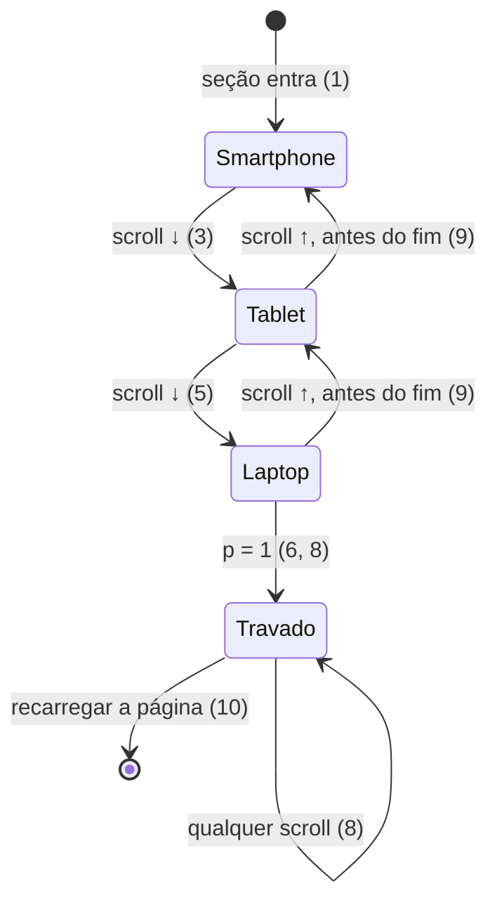

# Landing page do portfólio — carrossel de dispositivos (smartphone → tablet → notebook)

> Build this with **tlc-implement**. Every criterion below becomes a check with a proof, referenced
> by its number. Nothing under `Unresolved` gets settled while building.

## Intent

Hoje a seção `#notebook` mostra só um laptop abrindo com o site da Kune na tela. Quem visita vê o
trabalho em uma única tela, de desktop, e nada indica que os projetos funcionam em celular e
tablet. A fonte não traz números; o pedido é do próprio autor do portfólio.

Com a mudança, a mesma seção vira um carrossel guiado pelo scroll: um smartphone entra girando até
o centro mostrando o site; o scroll o leva para fora pela esquerda enquanto um tablet entra pela
direita; depois o tablet sai pela esquerda e o laptop entra pela direita, para no centro e abre
como hoje. Ao chegar ao fim, o carrossel trava no estado final e não se desfaz ao subir a página.

11 critérios em 4 fatias · 1 one-way door · 0 em aberto.

## Criteria

Fases do progresso `p` da seção (0 → 1), em `notebook/`. Os valores das janelas ficam numa
constante única (`STAGES`), como `STRAIGHTEN`/`OPEN`/`POWER_ON` hoje:

| Fase                              | Janela de `p` |
| --------------------------------- | ------------- |
| smartphone entra girando          | 0 – 0,20      |
| smartphone parado no centro       | 0,20 – 0,30   |
| smartphone sai ← / tablet entra ← | 0,30 – 0,45   |
| tablet parado no centro           | 0,45 – 0,55   |
| tablet sai ← / laptop entra ←     | 0,55 – 0,70   |
| laptop endireita, abre e liga     | 0,70 – 1      |

### Smartphone entra girando

1. Quando `p = 0`, o smartphone está afastado da câmera (menor na tela) e girado no eixo Y; entre
   `p = 0` e `0,20` ele gira uma volta completa (360°) mais o ângulo inicial e se aproxima até
   parar no centro, de frente para a câmera. Tablet e laptop não aparecem na tela.
2. Sempre que o smartphone está na tela, sua tela mostra o site `SCREEN_URL` (o mesmo do laptop),
   num `<iframe>` com largura CSS de 390 px, de modo que o site renderiza seu layout mobile.

### Smartphone sai, tablet entra

3. Quando `p` vai de 0,30 a 0,45, o smartphone desliza para a esquerda até sair inteiro da área
   visível, e o tablet desliza da direita (fora da tela) até o centro, de frente para a câmera.
4. Sempre que o tablet está na tela, sua tela mostra `SCREEN_URL`. Ele entra na vertical, com o
   `<iframe>` em 820 × 1180 CSS px; enquanto está parado no centro (0,45 – 0,55) ele gira 90° em Z
   para a horizontal e o conteúdo gira junto: o `<iframe>` passa a 1180 × 820 CSS px, de pé para
   quem vê, e o site refaz o layout para a nova largura. Sai pela esquerda já na horizontal.

### Tablet sai, laptop entra e abre

5. Quando `p` vai de 0,55 a 0,70, o tablet sai inteiro pela esquerda e o laptop, fechado, entra
   pela direita até o centro.
6. Quando `p` vai de 0,70 a 1, o laptop faz o que faz hoje, na mesma ordem e sobreposição:
   endireita da pose torta, abre a tampa até `LID_OPEN` e a página (1280 px) acende de opacidade 0
   para 1. Em `p = 1` a opacidade do iframe do laptop é ≥ 0,9.
7. Sempre, no máximo dois dispositivos estão visíveis ao mesmo tempo, e só durante uma troca; fora
   das janelas de troca há exatamente um.

### Estado final travado

8. Dado que `p` chegou a 1 ao menos uma vez nesta carga da página, quando o usuário rola para cima
   (inclusive para antes da seção e de volta), o progresso usado pela animação continua 1: laptop
   aberto, ligado, no centro; smartphone e tablet não reaparecem.
9. Dado que `p` ainda não chegou a 1, quando o usuário rola para cima, a animação volta junto com o
   scroll (comportamento de hoje), em qualquer fase.
10. Quando a página é recarregada, a trava se perde e o carrossel recomeça em `p = 0`.

### Todas as telas

11. Sempre, em qualquer viewport (incluindo retrato de celular de 390 × 844), cada dispositivo
    cabe inteiro na área visível quando está parado no centro — mesma regra `fit` do laptop
    (`Math.min(1, viewport.width / FRAME.width, viewport.height / FRAME.height)`), com um `FRAME`
    por dispositivo.

## States

## Out of scope

- Testes automatizados novos ou ajustados — decisão do usuário ("não precisamos de testes agora").
  Conflita com o princípio I da constituição geral; o usuário decidiu explicitamente.
- Interação com os dispositivos (arrastar, clicar, girar com o mouse) — não foi pedida.
- Persistir a trava entre cargas (`localStorage`/sessão) — não foi pedido; ver critério 10.
- Novos modelos `.glb` de terceiros ou de `canvas-lab` — ver `Decided`.
- Branch ou PR — o usuário pediu tudo na `main`.

## Observable

| Surface            | Decision                                | Landing                                                                                                                                      |
| ------------------ | --------------------------------------- | -------------------------------------------------------------------------------------------------------------------------------------------- |
| screen `#notebook` | empty state (iframe ainda não carregou) | existing - fundo `bg-ink` preto atrás do iframe, como no laptop                                                                              |
| screen `#notebook` | loading (modelo/geometria)              | existing - `<Suspense fallback={null}>` em `notebook-scene.tsx`                                                                              |
| screen `#notebook` | error (site embutido fora do ar)        | existing - o iframe mostra o que o navegador mostrar; tela preta por trás                                                                    |
| screen `#notebook` | unauthorised                            | n/a - página pública, sem login                                                                                                              |
| screen `#notebook` | density and ordering                    | 1, 3, 5, 7                                                                                                                                   |
| screen `#notebook` | destructive action confirms             | n/a - nenhuma ação                                                                                                                           |
| screen `#notebook` | reduced motion                          | existing - a animação do laptop já segue o scroll sob reduced motion (`e2e/reduced-motion.spec.ts`); o carrossel herda o mesmo comportamento |
| screen `#notebook` | acessibilidade                          | existing - `aria-label="Notebook"`, iframes `aria-hidden`, `tabIndex={-1}`, `pointer-events-none`; os iframes novos seguem o mesmo padrão    |

## Swept

- validation: n/a - nenhuma entrada do usuário além do scroll, que já é limitado a 0..1.
- failure modes: existing - `findParts` lança erro se o `.glb` do laptop não tiver os nós; os
  dispositivos novos são geometria em código, sem arquivo para faltar.
- idempotency and retry: n/a - nada é enviado nem gravado.
- authorization: n/a - página pública.
- concurrency and ordering: 8, 9 - a trava é monotônica (só passa de "aberta" a "travada").
- data lifecycle: 10 - a trava vive só na memória da página.
- external-dependency failure: existing - site embutido fora do ar mostra o que o navegador
  mostrar, com fundo preto; não bloqueia o carrossel.
- state transitions: 1, 3, 5, 6, 8, 9.
- observability: n/a - componente visual sem diagnóstico enviado.

## Impact

| Front       | What changes                                                                                                                                                                                                                                                    |
| ----------- | --------------------------------------------------------------------------------------------------------------------------------------------------------------------------------------------------------------------------------------------------------------- |
| domain      | novo termo: `Smartphone` - modelo 3D em código com tela `<Html transform>` de 390 px, em `components/organisms/notebook/`                                                                                                                                       |
| domain      | novo termo: `Tablet` - idem, 820 px                                                                                                                                                                                                                             |
| domain      | novo termo: `STAGES` - janelas de `p` de cada fase do carrossel; substitui o uso direto de `p` pelo laptop, que passa a receber o progresso **local** da sua fase (0,70 – 1 remapeado para 0 – 1), então `STRAIGHTEN`/`OPEN`/`POWER_ON` não mudam               |
| domain      | termo existente: `useScrollProgress` devolvia o progresso cru; passa a ter a trava (critério 8). Quem lê hoje: só `notebook.tsx`                                                                                                                                |
| domain      | termo existente: `Laptop` hoje começa centrado e torto; passa a entrar pela direita antes de endireitar                                                                                                                                                         |
| layout      | altura da seção `#notebook` sobe de `h-[300vh]` para `h-[600vh]` (ver Unresolved 3)                                                                                                                                                                             |
| desempenho  | 3 iframes do mesmo site carregam juntos quando a seção chega perto (`useNearViewport` com `SCREEN_LEAD`); hoje é 1                                                                                                                                              |
| testes e2e  | quebram sem ajuste (fora de escopo): `notebook.spec.ts` "three screens tall", `page-helpers.ts` `notebookEnd`/`gotoNotebook` (`#notebook iframe` passa a casar 3 elementos), `offscreen.spec.ts` e `hero.spec.ts` ("the only iframe"), `reduced-motion.spec.ts` |
| stored data | nothing to migrate                                                                                                                                                                                                                                              |

## Decided

| Decision                                                                                                          | Shape                                                                                                                                          | Alternative rejected                                                                                                                     |
| ----------------------------------------------------------------------------------------------------------------- | ---------------------------------------------------------------------------------------------------------------------------------------------- | ---------------------------------------------------------------------------------------------------------------------------------------- |
| Smartphone e tablet são geometria em código (`ExtrudeGeometry` de um retângulo arredondado, do three), não `.glb` | corpo extrudado + plano de tela + `<Html transform>` com iframe, no mesmo padrão de `laptop.tsx` (DISTANCE_FACTOR derivado da largura da tela) | `.glb` novo: não existe no repositório nem em `canvas-lab`, e criar exigiria ferramenta externa; nova lib 3D: proibida pelo princípio IV |

## Sources

- Conversa com o usuário (2026-11-03): "quero que adicione um smartphone e um tablet como modelos
  3D, exmplificando que meus projetos são responsívos e funcionam em todas telas", "comece com
  este smartphone [...] ele deve vir "Girando" até a tela e mostrar o mesmo conteúdo que o laptop
  mostra, funcionará como um carrocel: Smartphone -> Tablet -> Notebook", "ao scrollar mais ele
  sai da tela pela esquerda e um tablet entra pela direita, ao scrollar mais, o tablet sai pela
  esquerda e o laptop entra pela direita, chegando ao centro e abrindo", "não quero que ao
  scrollar para cima esse carrossel se "desfaça" quero que o estado permaneça o último, mas só
  após o usuário chegar ao fim do carrosel", "não precisamos de testes agora, faça tudo na main".
- Código: `components/organisms/notebook/{notebook,notebook-scene,laptop,use-scroll-progress}.tsx`.

This task is the record of decision. If a linked document diverges, ask before building.

## Unresolved

| #   | Kind | Question | Until answered |
| --- | ---- | -------- | -------------- |
| -   | -    | None     | -              |

Respondidas pelo usuário (2026-11-03): 1 — "Isso, o mesmo conteúdo" (390 / 820 px); 2 — "pode ser
na horizontal e na vertical, faça o conteúdo girar" (critério 4); 3 — "Ta bom" (`h-[600vh]`);
4 — "Isso, pode ser, depois vamos revendo" (1 volta em Y + aproximação).
