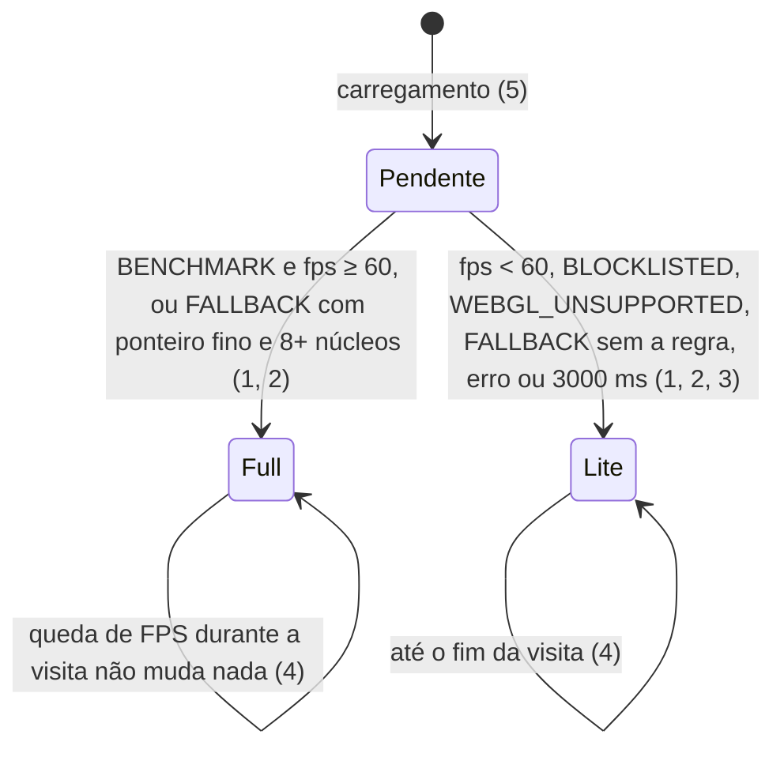

# Landing page do portfólio — verificação do aparelho: 3D só onde a GPU aguenta 60 FPS, zero WebGL no toque

> Build this with **tlc-implement**. Every criterion below becomes a check with a proof, referenced
> by its number. Nothing under `Unresolved` gets settled while building.

## Intent

Mesmo depois de `portfolio-lp-still-scenes`, o site continua pesado no celular (usuário, 2026-11-16:
"Este site ainda está muito pesado em dispositivos móveis"). O usuário não passou medição. O que o
código mostra (fato, salvo onde marcado):

- **No toque, o único WebGL que sobra é o globo do rodapé.** A Hero e o Alcance já são imagens
  (`firstSceneMode` em `lib/scene-mode.ts`), os ícones de Soluções são SVG (`glass-shelf.tsx`) e o
  `GlassStage` não é montado (`glass-stage.tsx`). O globo é um canvas de 52 000 pontos de rede
  (`LATTICE`, `globe-scene.tsx`), com vapor e bloom, a pixel ratio fixo de `[1.5, 2]`, que ocupa a
  seção de Contato mais meia tela acima dela.
- **A decisão entre completo e leve não é determinística.** `lib/watch-performance.ts` mede o FPS
  durante a visita. Uma cena só vira imagem, ou a página só fica leve, depois que 3 de 5 janelas
  ficam abaixo de 50 FPS (`createJudge`, `performance-tier.ts`). Até lá o aparelho fraco já travou.
  O mesmo aparelho pode terminar a visita em estados diferentes.
- **O modo leve de hoje não é leve.** Ele só congela efeitos (céu parado, sem blur, sem Lenis, sem
  glitch, ícones planos) e mantém o globo em 3D (`you-are-here.tsx`). No desktop, ele mantém também
  a Hero e o Alcance em 3D até cada um ser reprovado sozinho.
- O resto do custo no toque é DOM e CSS: 240 estrelas distantes com brilho animado
  (`FAR_STARS`, `night-sky.ts`), o parallax, o `backdrop-filter` dos cards e o carrossel do Alcance
  em CSS 3D (`still-carousel.tsx`). Que isso pese no celular do usuário é suposição.

Depois desta task, a página decide uma vez, ao carregar, se o aparelho roda o site completo. Ela
identifica a GPU com `detect-gpu` e consulta a tabela de benchmarks dessa biblioteca. A decisão não
muda durante a visita. Celulares e tablets nunca criam um canvas WebGL para desenhar: o globo
também vira imagem, com o pin do visitante por cima. O aparelho reprovado, de qualquer tipo,
recebe a versão leve: nenhum WebGL e todos os efeitos da página desligados. O desktop aprovado
mantém tudo em 3D, como hoje, e não troca mais nada no meio da visita.

17 critérios em 5 fatias · 2 one-way doors · 5 em aberto, nenhum bloqueia.

**Medição** (vale para o critério 17; é a régua de `portfolio-lp-mobile-smooth`):

- **Ambiente:** build de produção; Chromium de `playwright.config.ts` com as flags de GPU.
- **Celular:** 390×844, `isMobile`, `hasTouch`, DPR 3.
- **Lentidão:** CPU via CDP `Emulation.setCPUThrottlingRate`, ligada depois do carregamento.
- **FPS:** quadros de `requestAnimationFrame` divididos pelo tempo de uma janela de 3 s.
- **Limiar:** 58, que é o "60 FPS" do usuário com a folga de jitter do `requestAnimationFrame`
  (mesmo motivo de `portfolio-lp-60fps`).

**Toque** = `FINE_POINTER` falso (`lib/media-preferences.ts`), lido uma vez por visita
(`isFinePointer`, `lib/use-fine-pointer.ts`).

## Criteria

### A verificação do aparelho

1. Quando a landing carrega, a página chama `getGPUTier` (`detect-gpu` 5.0.70) uma única vez, com
   `benchmarksURL` apontando para a própria origem (`/detect-gpu/benchmarks`). Ao responder, ela marca
   `<html data-performance="full">` se o resultado tem `type: "BENCHMARK"` e `fps ≥ 60`. Se o
   resultado é `BLOCKLISTED`, `WEBGL_UNSUPPORTED` ou tem `fps < 60`, ela marca
   `<html data-performance="lite">`. Nenhuma requisição sai para `unpkg.com`.
2. Se o resultado é `type: "FALLBACK"` (GPU sem dado de benchmark, como o Safari do Mac, que só
   informa "Apple GPU"), o tier é `full` quando o ponteiro é fino e
   `navigator.hardwareConcurrency ≥ 8`. Nos demais casos é `lite` (Unresolved 1).
3. Se `getGPUTier` lança erro ou não responde em 3000 ms, o tier é `lite` (Unresolved 4).
4. Sempre, os mesmos renderer, tamanho de tela, ponteiro e núcleos dão o mesmo tier. O tier é
   decidido uma vez por visita e nunca muda: a página não mede FPS durante a visita e nenhuma cena
   troca de 3D para imagem depois de montada (`watchPerformance`, `turnStill` e o crossfade de 600 ms
   deixam de existir).
5. Enquanto a verificação não respondeu, `<html>` não tem `data-performance`, nenhuma cena monta
   canvas nem imagem, e o véu de carregamento continua de pé. Depois que a Hero monta, o véu se
   levanta no `hero-ready`, como hoje.
6. Sempre, o contexto WebGL que a verificação usa para ler o renderer é liberado
   (`WEBGL_lose_context`) antes de a primeira cena montar.

### Toque: nenhum WebGL

7. Dado um dispositivo de toque, em qualquer tier, a página não tem nenhum `<canvas>` com contexto
   WebGL. A Hero, o Alcance e o Contato marcam `data-scene="still"`.
8. Dado um dispositivo de toque, o globo do Contato é uma imagem da Terra pontilhada com a sua luz,
   renderizada da cena viva. Ela sobe meia tela acima da seção com a mesma máscara de hoje
   (`-50svh`, gradiente até `50svh`). A imagem é desenhada com no máximo 1 px do aparelho por px da
   imagem em 390×844 DPR 3, 820×1180 DPR 2 e 1440×900 DPR 2 (`object-fit` × `devicePixelRatio` ≤ 1).
9. Quando o local do visitante é encontrado e cai na face visível da imagem do globo (até 75° do
   centro da face), um pin aparece no ponto projetado, com o anel pulsando a cada 2,4 s e crescendo
   até 3,2× (`PULSE`). Fora da face visível, ou sem local, não aparece pin. Com movimento reduzido,
   o anel não pulsa (Unresolved 2).
10. Se a imagem do globo falhar, a seção de Contato mostra o texto sobre o céu da página, sem
    mensagem de erro.

### Desktop aprovado: tudo em 3D, sem trocas

11. Dado ponteiro fino e tier `full`, a Hero, o Alcance e o globo desenham em 3D
    (`data-scene="live"`) e o `GlassStage` é montado, como hoje. Eles continuam em 3D até o fim da
    visita, mesmo que o FPS caia (critério 4).

### Versão leve, em qualquer dispositivo

12. Dado tier `lite`, a página não tem nenhum `<canvas>` com contexto WebGL. A Hero, o Alcance e o
    Contato marcam `data-scene="still"`. O `GlassStage` e o cursor de vidro não são montados, e o
    cursor do sistema aparece em toda a página.
13. Dado tier `lite`, os efeitos da página ficam desligados como no modo leve de hoje: céu parado
    (sem deslocamento de parallax e sem brilho das estrelas), `.glass-card` sem `backdrop-filter`,
    brilho das seções parado, sem Lenis, sem glitch e ícones de Soluções planos.
14. Dado ponteiro fino e tier `lite`, o Alcance em imagens mantém a ordem e o zoom do carrossel em
    imagens: o laptop por último a partir de 1024 px e o zoom na tela dele entre 0,80 e 0,96 do
    progresso (`STAGES.zoom`).

### As imagens do globo

15. `node scripts/render-stills.mjs` gera também as imagens do globo (`?capture=globe`), com o globo
    parado na pose da imagem, sem pin e sem giro, nas formas que a página serve, e as registra em
    `lib/stills.json` com o `srcset` de cada forma.
16. Sempre, o ponto do pin sobre a imagem vem da mesma latitude e longitude que a cena viva usa
    (`toSphere`), projetado com a pose e a câmera da imagem (`fov` 35, distância 3,4). Num local no
    centro da face, o pin fica a no máximo 4 px CSS do centro do globo desenhado, em 390×844 e em
    1440×900.

### Medição no celular

17. Em 390×844 no toque, parado na Hero e depois rolando o Alcance e o Contato de ponta a ponta, a
    página mantém pelo menos 58 FPS nas duas situações: tier `lite` com CPU 6× e tier `full` com
    CPU 4× (Unresolved 3).

## States

## Out of scope

- Medir FPS durante a visita como rede de segurança: o usuário escolheu uma verificação que "roda
  uma vez, ao carregar, e não muda durante a visita".
- Guardar a decisão entre visitas (`localStorage`): a verificação é determinística e roda de novo
  com o mesmo resultado.
- O carrossel do Alcance em CSS 3D (`still-carousel.tsx`): são imagens transformadas pelo
  compositor, não WebGL. Ele fica como está.
- O Soundscape: é áudio, não desenha.
- Medir no aparelho real (Redmi Note 11 Pro): fica com o usuário (Unresolved 5).
- Nova direção de arte para o globo: a imagem é um render da cena de hoje.

## Observable

| Surface                  | Decision                                  | Landing                                                                           |
| ------------------------ | ----------------------------------------- | --------------------------------------------------------------------------------- |
| screen landing           | loading enquanto a verificação não responde | 5                                                                               |
| screen landing           | error da verificação                      | 3                                                                                 |
| screen landing, Hero     | o que mostra no toque e no lite           | 7, 12; existing - a Hero em imagem de `portfolio-lp-still-scenes` (1 a 4)         |
| screen landing, Alcance  | o que mostra no toque e no lite           | 7, 12, 14; existing - o carrossel em imagens de `portfolio-lp-still-scenes` (5 a 8) |
| screen landing, Contato  | globo no toque e no lite                  | 8, 12                                                                             |
| screen landing, Contato  | pin do visitante                          | 9, 16, Unresolved 2                                                               |
| screen landing, Contato  | error (imagem do globo falha)             | 10                                                                                |
| screen landing, Contato  | local não encontrado                      | 9 (sem pin); existing - o texto não depende do local (`portfolio-lp-reach-and-seams`, 20) |
| screen landing           | cursor no lite                            | 12                                                                                |
| screen landing           | efeitos da página no lite                 | 13                                                                                |
| screen landing           | empty / unauthorised / ação destrutiva    | n/a - página estática pública, sem dados do visitante nem ações                   |
| command `render-stills`  | saída, flags, falha no meio               | 15; existing - o script de hoje (`BASE` como único argumento, para na primeira falha do Playwright) |

## Swept

- validation: n/a - não há entrada do usuário. O resultado de `getGPUTier` é tratado pelo `type` e pelo `fps` (1, 2, 3)
- failure modes: 3, 10
- idempotency and retry: 4 - a verificação roda uma vez por visita, e um recarregamento repete o mesmo resultado
- authorization: n/a - página pública
- concurrency and ordering: 5 - nenhuma cena monta antes do tier, então nenhuma cena começa num modo e troca para outro
- data lifecycle: n/a - imagens e benchmarks estáticos em `public/`, versionados com o código ou copiados do pacote
- external-dependency failure: 3 - os benchmarks vêm da própria origem; a falha deles cai em `lite`
- state transitions: 1, 2, 3, 4 (pendente → full | lite, nunca de volta)
- observability: n/a - site pessoal sem telemetria. `data-performance` em `<html>` e `data-scene` nas seções são o que se inspeciona no aparelho

## Impact

| Front       | What changes |
| ----------- | ------------ |
| domain      | existing term: `PerformanceTier` (`full` \| `lite`) começava `full` e virava `lite` medindo FPS. Passa a nascer de `getGPUTier` ao carregar, com um estado pendente antes (sem `data-performance`). Quem depende: `app/layout.tsx`, `app/globals.css` (seletores `[data-performance='lite']`), `glitch-text.tsx`, `smooth-scroll.tsx`, `parallax-field.tsx`, `glass-shelf.tsx`, `glass-icon.tsx`, `glass-stage.tsx`, `render-gate.tsx`, `you-are-here.tsx`, `lib/use-lite-mode.ts`, `lib/performance-tier.test.ts` |
| domain      | existing term: `SceneMode` / `lib/scene-mode.ts` começava pelo ponteiro e trocava cena a cena (`turnStill`). Passa a ser `live` só com ponteiro fino e tier `full`, para a visita toda, e ganha a cena `globe`. `turnStill`, `setSceneDrawing`, `drawingScenes` e `anyLiveScene` deixam de existir. Quem depende: `hero.tsx`, `notebook.tsx`, `handheld.tsx`, `laptop.tsx`, `lib/use-scene-mode.ts` |
| domain      | existing term: `lib/watch-performance.ts`, `PerformanceWatch` (`components/atoms/performance-watch`), `createJudge`, `windowRate`, `isSlowWindow` e as constantes de janela (`BELOW_FPS`, `SCENE_WINDOW_MS`, `STALL_MS`, `PAUSE_MS`, `WARM_UP_MS`, `SLOW_WINDOWS`, `RECENT_WINDOWS`) são removidos. Os testes de unidade deles e os testes e2e da troca no meio da visita (`e2e/performance.spec.ts`, critérios 11 a 13 e 16 de `portfolio-lp-still-scenes`) são reescritos para os critérios 1 a 5 e 11 desta task, não apagados sem substituto |
| domain      | new term: imagens do globo, renders da cena viva em `public/stills/`, registradas em `lib/stills.json` ao lado da Hero e dos aparelhos. `CaptureTarget` ganha `globe` |
| domain      | existing term: `data-scene` marcava só a Hero e o Alcance. Agora marca também a seção de Contato |
| tests       | o Chromium dos testes informa o próprio renderer, que pode cair em `BLOCKLISTED` (SwiftShader). Os e2e fixam o tier sobrescrevendo `UNMASKED_RENDERER_WEBGL` com `page.addInitScript`. Nenhum parâmetro de URL novo vai para produção |
| source      | `.tasks/portfolio-lp-still-scenes.md`: os critérios 11, 12, 13 e 16 (a troca medida durante a visita e o lite abaixo de 50 FPS) e o 17 (o globo 3D em todo dispositivo) passam a valer como substituídos por esta task. Uma nota no topo daquele arquivo aponta para cá |
| stored data | nothing to migrate |

## Decided

| Decision | Shape | Alternative rejected |
| -------- | ----- | -------------------- |
| Dependência nova para decidir o tier | `detect-gpu@5.0.70` (MIT; depende de `webgl-constants`), `getGPUTier({ benchmarksURL: '/detect-gpu/benchmarks', desktopTiers: [0, 15, 30, 60], mobileTiers: [0, 15, 30, 60] })`. Os dados de benchmark (`dist/benchmarks/*.json`, 712 KB no total, um arquivo por fabricante buscado por visita) são servidos da própria origem e copiados da mesma versão instalada do pacote | regra escrita à mão (núcleos, memória, lista de GPUs): não estima FPS. Benchmark ao carregar: varia entre visitas, não é determinístico. `benchmarksURL` padrão do pacote (`unpkg.com`): manda o IP do visitante a terceiro e adiciona um ponto de falha externo |
| Nenhuma troca de modo durante a visita | o tier e o `SceneMode` são lidos uma vez e não têm caminho de volta nem de ida; o vigia de FPS sai do código | manter o vigia como rede de segurança: contradiz o "não muda durante a visita" escolhido pelo usuário, e é a parte não determinística que motivou esta task. Fecha a porta para um aparelho aprovado que mesmo assim trave: ele fica em 3D até recarregar |

## Sources

- Mensagem do usuário, 2026-11-16 (sem endereço). Trechos que decidem:
  - "Este site ainda está muito pesado em dispositivos móveis, diminua a quantidade de elementos 3D
    nos dispositivos móveis"
  - "faça uma verificação deterministica para verificar se é um dispositivo que consegue rodar
    plenamente o site a 60 FPS, caso não seja, coloque a versão leve do site, que você deve fazer"
- Respostas do usuário, 2026-11-16 (sem endereço):
  - Verificação: "detect-gpu (Recomendado)", sobre a pergunta "Ela roda uma vez, ao carregar, e não
    muda durante a visita".
  - Versão leve: "Zero WebGL no toque (Recomendado)": celulares e tablets sempre mostram o globo
    como imagem estática, com o pin do visitante por cima quando o local está na face visível. A
    versão leve, em qualquer dispositivo reprovado, não tem nenhum WebGL: Hero, Alcance e globo em
    imagem, céu parado, sem blur, sem glitch, sem Lenis e ícones planos.
- `detect-gpu` 5.0.70, README e `dist/detect-gpu.esm.js` do pacote no npm: os tiers por FPS
  (`>= 15`, `>= 30`, `>= 60`), os `type` (`BENCHMARK`, `FALLBACK`, `BLOCKLISTED`,
  `WEBGL_UNSUPPORTED`), o `benchmarksURL` e o `override.renderer`. No desktop, o renderer
  "apple gpu" não casa com nenhuma linha de `d-apple.json` e volta como `FALLBACK` (leitura do
  código, não testado em um Mac).
- `.tasks/portfolio-lp-still-scenes.md`: a Hero e o Alcance em imagens, que esta task estende ao
  globo e ao lite do desktop.
- `.tasks/portfolio-lp-mobile-smooth.md`: a régua de medição no celular.

This task is the record of decision. If a linked document diverges, ask before building.

## Unresolved

| # | Kind | Question | Until answered |
| - | ---- | -------- | -------------- |
| 1 | open | O que fazer quando o `detect-gpu` não conhece a GPU (`FALLBACK`)? Isso inclui o Safari em qualquer Mac e as GPUs lançadas depois dos dados do pacote (publicado em 2025-02). | Critério 2: `full` com ponteiro fino e 8 ou mais núcleos; `lite` nos demais casos. |
| 2 | open | Em que pose fica a imagem do globo? A cena viva gira até o local do visitante, e a imagem não gira. | Critérios 9 e 15: centro da face em latitude −15°, longitude −50° (Brasil), com a inclinação da cena viva (`PLACE_ABOVE_MIDDLE`). Locais a mais de 75° desse centro ficam sem pin. |
| 3 | open | Que lentidão representa um celular aprovado (`full`) na régua do Chromium? | Critério 17: CPU 4× para `full` e 6× para `lite`. |
| 4 | open | Quanto esperar pela verificação antes de cair em `lite`? | Critério 3: 3000 ms. |
| 5 | open | O aparelho do usuário (Redmi Note 11 Pro) passa como `full` ou `lite`? Pela GPU, provavelmente cai em `lite` (suposição: Mali-G57 MC2 no modelo 4G e Adreno 619 no 5G). | Provas em Chromium. O usuário confirma no aparelho lendo `<html data-performance>`. |
